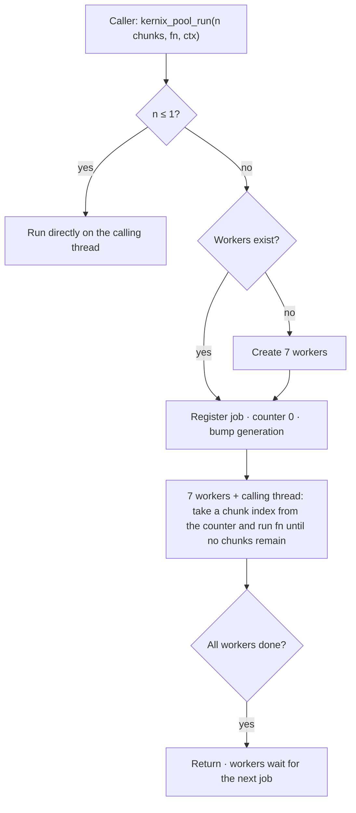

# KERNIX

**KERNIX** is a C tensor library and model inference runtime for Apple Silicon Macs. It uses the M1's CPU cores, AMX matrix accelerator, and GPU **at the same time** on unified memory. Export an MLP, CNN, RNN, or Transformer trained in PyTorch or Keras to a `.knx` file, then run it from C or Python (numpy only), with no TensorFlow or PyTorch at inference time.

> **Status: experimental.** macOS + Apple Silicon only. All measurements were taken on an M1.

## Contents

- [Features](#features)
- [Requirements](#requirements)
- [Installation](#installation)
- [Quick start](#quick-start)
- [Usage](#usage): model conversion, Python API, C API, tensor library
- [Supported models and layers](#supported-models-and-layers)
- [Strengths and limitations](#strengths-and-limitations)
- [Architecture](#architecture)
- [Benchmarks](#benchmarks)
- [Documentation](#documentation) · [Roadmap](#roadmap)

## Features

| Area | Description |
|---|---|
| **Model inference runtime** (`include/kernix_model.h`) | Loads and runs `.knx` models, including graph models with convolutions, RNNs, attention, and residual connections. No allocation during forward when the batch size is unchanged; large batches run in chunks under a workspace limit (64 MB by default) |
| **Model export** (`tools/`) | Converts Keras (`.h5`, Sequential and functional) and PyTorch (models saved with `torch.save`, traced with `torch.fx`) to `.knx`. BatchNorm and Normalization are folded into the preceding layer's weights |
| **int8 quantization** | `--quantize int8`: files about 3.5× smaller, NEON `sdot` int8 matmul for small sample counts |
| **Python binding** (`python/kernix.py`) | One line: `Model(path)(x)`. Needs only numpy. Each model has a lock, so calling it from several threads is safe |
| **Concurrent GPU + AMX matmul** | The GPU (MPS) and AMX compute different rows of the same output buffer at the same time. The split ratio is calibrated automatically per size bucket. Bias and activation run on the GPU for GPU rows and on the CPU for CPU rows |
| **27 tensor ops** (`include/kernix.h`) | Unary, binary, scalar, reductions, softmax, layer_norm, transpose. Small tensors on the CPU (SIMD + GCD), large tensors on the Metal GPU |
| **Fused op** | `relu(a·x + b)` in a single pass over memory |
| **Thread pool** (`src/kernix_runtime.c`) | Reused workers, dynamic chunk distribution (faster cores take more chunks), serial for small inputs |
| **Hardened loader** | `.knx` files are treated as untrusted input: truncated files, forged sizes, and invalid connections are rejected. Verified with ASan/UBSan fuzzing |

## Requirements

| Purpose | Needed |
|---|---|
| Build | macOS, Apple Silicon, Xcode Command Line Tools (`clang`, Accelerate, Metal frameworks) |
| Run from Python | Python 3 + numpy |
| Convert PyTorch models | PyTorch (measured with 2.14.1) |
| Convert Keras models | TensorFlow 2.16 / Keras 3 |

## Installation

To use KERNIX from C, install the headers and static libraries. If you only need Python, skip installation and run `make python-lib` from [Quick start](#quick-start).

```bash
./install_mac.sh                   # install to /usr/local (use sudo if you lack write access)
PREFIX=~/.local ./install_mac.sh   # install somewhere else
./install_mac.sh --uninstall       # remove installed files
```

`./install.sh` is the same script. It installs these files:

| File | Location | Purpose |
|---|---|---|
| `kernix.h`, `kernix_model.h` | `$PREFIX/include` | Tensor ops, model runtime (header-only) |
| `libkernix.a` | `$PREFIX/lib` | Thread pool: required by every build |
| `libkernix_metal.a` | `$PREFIX/lib` | Metal GPU code: only for `-DKERNIX_USE_METAL` builds |

After installing, build like this:

```bash
# CPU + AMX (Accelerate)
clang -O3 -std=c11 -DKERNIX_USE_ACCELERATE app.c -lkernix -framework Accelerate -o app

# CPU + AMX + GPU (Metal): pass -DKERNIX_USE_METAL to every source that includes kernix.h
clang -O3 -std=c11 -DKERNIX_USE_ACCELERATE -DKERNIX_USE_METAL app.c -lkernix -lkernix_metal \
      -framework Accelerate -framework Metal -framework MetalPerformanceShaders -framework Foundation -o app

# Plain C (no acceleration: tensor ops and thread pool only)
clang -O3 -std=c11 app.c -lkernix -o app
```

- If you installed somewhere other than `/usr/local`, add `-I$PREFIX/include -L$PREFIX/lib`.
- To build only the libraries, run `make lib`. Output goes to `build/`.

## Quick start

The shortest path to running a model from Python. For C, see [Installation](#installation) and [C API](#c-api).

```bash
# 1. Build the library for the Python binding (python/libkernix.dylib)
make python-lib

# 2. Convert a model to .knx
python tools/convert.py model.pt model.knx --input-shape 3,32,32   # PyTorch
python tools/convert.py model.h5 model.knx                         # Keras (with a Python that has tensorflow)
```

```python
# 3. Run (add python/ to the import path)
import sys; sys.path.insert(0, "python")
from kernix import Model

m = Model("model.knx")
y = m(x)   # x: (batch, *m.in_shape) float32 → (batch, *m.out_shape)
```

## Usage

### Model conversion

```bash
# PyTorch: a file saved with torch.save(model, "model.pt") (a state_dict alone does not describe the architecture)
python tools/convert.py model.pt model.knx [--quantize int8] [--input-shape 3,32,32]

# Keras: .h5 or .keras (with a Python that has tensorflow)
python tools/convert.py model.h5 model.knx [--quantize int8]
```

- **Framework and format are chosen automatically.** The extension decides (`.pt`/`.pth` is PyTorch, `.h5`/`.keras` is Keras), and only that framework is imported.
  - Sequential MLPs (PyTorch `nn.Sequential`) and sequential LSTM/Dense models (Keras) are written in the original format (KNX1, or KNX2 with int8).
  - Everything else (CNN, GRU, bidirectional, Transformer, residual connections, ...) is written in the graph format (KNX3).
- **`--input-shape`** (PyTorch only): the input shape of one sample, in PyTorch order, without the batch axis. Examples: image `3,32,32`, sequence `20,8`, tokens `10`. Can be omitted when the first layer is `Linear`.
- **Input shapes are fixed.** Sequence length and image size are stored in the file, so export again for a different length.
- **Unsupported layers or settings** stop the export with a `ValueError` that names the reason ([supported list](#supported-models-and-layers)).
- **Warning**: `torch.load` unpickles the file, which runs any code inside it. Only convert files you created yourself.

### Python API

```python
from kernix import Model

m = Model("model.knx")                 # ValueError if the file is invalid
m.in_shape, m.out_shape                # input and output shape of one sample
y = m(x)                               # (batch, *in_shape) → (batch, *out_shape); the result is a copy owned by the caller
y = m(x.reshape(-1, m.in_dim))         # the older (rows, in_dim) form also works (rows must be a multiple of m.seq_len)

m = Model("model.knx", workspace_mb=16)  # workspace limit: larger batches run in chunks (default 64, 0 = no limit)
m.trim()                                 # return the workspace to the OS while idle after a large batch (weights are kept)
```

- **Input layout**: pass images as `(batch, H, W, C)` (Keras). Convolutional models exported from PyTorch take and return `(batch, C, H, W)` (`m.channels_first` is True); the binding moves the channel axis.
- **Dtype**: float64 or non-contiguous arrays are converted to contiguous float32. Token ids (Embedding input) are passed as floats too.
- **Threads**: one `Model` can be called from several threads, but calls run one at a time. For true concurrency, create one `Model` per thread.
- **Build**: the Python library is an Accelerate build and does not use the GPU. For one-sample-at-a-time inference such as a webcam loop, GPU launch latency would only add cost.

### C API

```c
#include "kernix_model.h"

kernix_model* m = kernix_model_load("model.knx");          /* NULL on failure, reason on stderr */
float_tensor* x = float_zeros(4 * m->seq_len, m->in_dim);  /* 4 samples: seq_len rows × in_dim each (NHWC, T×F) */
const float_tensor* y = kernix_model_forward(m, x);        /* 4 × out_dim. Owned by the model: do not free; the next forward overwrites it */
kernix_model_set_workspace_limit(m, 16 << 20);             /* workspace limit in bytes (0 = no limit) */
kernix_model_trim(m);                                      /* release the workspace */
float_free(x);
kernix_model_free(m);
```

Building straight from the repository:

```bash
# Accelerate build (CPU + AMX)
clang -O3 -std=c11 -I./include -DKERNIX_USE_ACCELERATE -framework Accelerate src/kernix_runtime.c app.c -o app

# Metal build (CPU + AMX + GPU): uses the GPU as well for large batches
clang -O3 -std=c11 -I./include -DKERNIX_USE_ACCELERATE -framework Accelerate \
      -DKERNIX_USE_METAL -fobjc-arc src/kernix_metal.m -framework Metal -framework MetalPerformanceShaders -framework Foundation \
      src/kernix_runtime.c app.c -o app
```

- Do not call `forward` on the same model from several threads at once (its buffers are shared). Different models can run concurrently.
- `-DKERNIX_USE_METAL` must be passed to every source file that includes `kernix.h`, so that `float_free` recognizes Metal allocations.
- To build against the installed headers and libraries instead, see [Installation](#installation).

### Tensor library (`kernix.h`)

Two-dimensional contiguous tensors (`float_tensor`, `int_tensor`, `uint8_tensor`) and their ops in a single header. Build flags decide which hardware runs them.

| Mode | Flags | Runs on |
|---|---|---|
| Native | (none) | Plain C + thread pool |
| Accelerate | `-DKERNIX_USE_ACCELERATE -framework Accelerate` | AMX (matmul), NEON (vDSP), GCD parallelism |
| Metal | Accelerate + `-DKERNIX_USE_METAL` + `src/kernix_metal.m` | Accelerate + GPU (MPS, hand-written Metal kernels) |

```c
float_tensor* c = float_matmul_metal(a, b);   /* concurrent GPU + AMX matmul (Metal build) */
float_tensor* y = floats_softmax(x);          /* 27 ops: floats_relu, floats_layer_norm, floats_transpose, ... */
float_tensor* z = floats_fma_relu_metal(a, x, b);  /* relu(a·x + b) in a single pass over memory */
```

## Supported models and layers

| Kind | Keras | PyTorch |
|---|---|---|
| **MLP** | Dense, TimeDistributed(Dense) | Linear |
| **Normalization** | BatchNormalization, LayerNormalization, Normalization, Rescaling | BatchNorm1d/2d, LayerNorm |
| **Convolution** | Conv1D/2D (valid/same/causal, strides, dilation, groups), DepthwiseConv1D/2D, SeparableConv1D/2D | Conv1d/2d (including `padding='same'`, stride, dilation, groups/depthwise) |
| **Pooling** | Max/AveragePooling1D/2D, GlobalAverage/MaxPooling1D/2D | Max/AvgPool1d/2d, AdaptiveAvg/MaxPool, global pooling via `mean`/`amax` |
| **RNN** | LSTM, GRU, SimpleRNN, Bidirectional (concat/sum/mul/ave) | LSTM, GRU, RNN (batch_first, multi-layer, bidirectional). `out[:, t]`, `h_n[-1]` (and `h_n[-2]` when bidirectional) |
| **Transformer** | MultiHeadAttention (self/cross, causal mask, value_dim, output_shape) | MultiheadAttention (kdim/vdim, causal mask), TransformerEncoderLayer/Encoder (norm_first, relu/gelu) |
| **Embedding** | Embedding | Embedding, adding a positional parameter |
| **Graph merges** | Add, Subtract, Multiply, Maximum, Minimum, Average, Concatenate (first/last axis), nested models | `+ − × ÷`, `torch.cat`, ops with constants |
| **Shape** | Flatten, Reshape, Permute, ZeroPadding, UpSampling (nearest), Cropping | flatten/view/reshape/squeeze/unsqueeze, permute/transpose, `x[:, i]`, `x[:, a:b]`, ZeroPad/ConstantPad(0), F.pad, Upsample/interpolate (nearest) |
| **Activations** (16) | relu, gelu, silu/swish, sigmoid, tanh, softmax, elu, selu, softplus, relu6, hard_sigmoid, hard_silu, mish, softsign, leaky_relu, exponential; ReLU/LeakyReLU/ELU/PReLU layers | ReLU, GELU (none/tanh), SiLU, Sigmoid, Tanh, Softmax, ELU, SELU, Softplus, ReLU6, Hardsigmoid, Hardswish, Mish, Softsign, LeakyReLU, PReLU, and the matching `F` functions |
| **Skipped** | Dropout variants, InputLayer | Dropout, Identity |

**Not supported** (rejected at export)
- Layers: ConvTranspose (Conv2DTranspose), GroupNorm
- Masks: attention padding masks (`attention_mask`, `key_padding_mask`), non-causal masks, Embedding `mask_zero`
- Inputs: Keras models trained channels_first, inputs with undefined length
- RNN: stateful RNNs, Keras GRU `reset_after=False`
- Other: Keras `Lambda`, indexing that slices a middle axis, permutes that move the batch axis

## Strengths and limitations

Figures come from the [Benchmarks](#benchmarks) section (Apple M1).

| Strength | Why | Measured |
|---|---|---|
| **Fast single-sample inference** | No per-op framework overhead (PyTorch CPU about 30–60 µs, MPS about 150–300 µs) | Sign language models per frame **3.1–3.7×** vs TFLite, GPT **13.9×**, ResNet **2.6×** (sections 7 and 9) |
| **Fast small and medium tensor ops** | Accelerate SIMD functions run directly, split into 32 KB ranges over GCD | Median **2.2–3.3×** vs best PyTorch backend for 27 ops at 256²–1024² (section 4) |
| **CPU and GPU at once** | On unified memory, the GPU (MPS) and AMX compute different rows of the same output buffer without copies. PyTorch uses one device at a time | Large matmul 1.1–1.5× vs PyTorch MPS, small and medium 2–250× (section 2) |
| **Op fusion** | `relu(a·x + b)` in one pass over memory (PyTorch eager makes three) | 1.6–9.9× vs best PyTorch (section 3) |
| **Same results as the original** | Weights are copied as-is and op order is matched | 100% prediction agreement with TFLite (section 7); 38 zoo models within ~1e-7 relative error (section 9) |
| **Lightweight deployment** | No TensorFlow or PyTorch needed for inference. C needs the headers, Python needs numpy | Webcam script starts in 0.6 s (TensorFlow 3.6 s); peak process memory 66 MB (PyTorch 427 MB, section 6) |
| **Predictable memory** | Batches over the workspace limit run in chunks; `trim()` returns memory to the OS | Word model full batch 513 MB → 64.5 MB at the same speed (section 8) |
| **Smaller and faster with int8** | int8 weights + NEON `sdot` for few samples, AMX float for many | Files about 3.7× smaller (fingerspelling 132 KB → 36 KB), single sample 1.9–3.3× faster (design-phase measurement) |
| **Any batch size** | The same `.knx` accepts any batch | The project's `.tflite` files are fixed to batch 1 |

**Limitations**
- **Large batches** are faster in PyTorch MPS for MLPs: batch 4096 runs at 0.86× (section 6). ResNet at batch 64 is on par (1.0×, section 9).
- **CNNs are faster in Core ML**: on the ResNet in section 9, Core ML is 1.9× faster at batch 1 and 13× faster at batch 64 (Neural Engine, float16).
- **Elementwise ops at 4096² and above** are memory-bandwidth bound and match PyTorch.
- **The int8 fingerspelling model** agrees with TFLite on only 98.94% of confirmed webcam predictions, below the 99% target.
- **Input shapes are fixed in the file** (no dynamic sequence length). Training is not supported.

## Architecture

```
include/kernix.h          Tensor structs, 27 ops, matmul, thread pool declarations, size-based device selection
include/kernix_model.h    .knx loader (validation), shape inference, buffer planning, 21 graph ops, int8 kernels
src/kernix_runtime.c      Thread pool (part of every build)
src/kernix_metal.m        Metal: GPU+AMX split matmul, GPU epilogue, elementwise and row kernels, shared buffer cache
src/kernix_capi.c         C API for the Python binding (python/libkernix.dylib)
install_mac.sh            Installs headers and static libraries (make lib → build/); install.sh is the same script
python/kernix.py          Python binding (ctypes + numpy)
tools/convert.py          Conversion command (picks PyTorch or Keras by extension)
tools/export_torch.py     PyTorch → .knx (sequential MLP as KNX1/2, everything else as KNX3 via torch_graph.py and torch.fx)
tools/export_keras.py     Keras → .knx (sequential LSTM/Dense as KNX1/2, everything else as KNX3 via keras_graph.py)
tools/knx3.py             KNX3 graph writer (shared by both graph exporters); knx_quant.py: int8 weight blocks
docs/                     Design documents
```

**How the model runtime works**
- **Value storage**: every value in the graph has a channels-last shape for one sample (image H×W×C, sequence T×F). Buffers hold it as 2-D: `(batch · product of leading axes) × channels`.
- **Convolution**: im2col and matmul run tile by tile (2 MB tiles across 4 parallel lanes), so the unrolled matrix stays in cache and one lane unrolls while another uses AMX. All convolutions share one tile-sized im2col buffer, so it does not grow with the batch. 1×1 convolutions skip im2col; depthwise convolutions use channel-wise vector ops.
- **Zero-copy reshapes**: Flatten and Reshape only change the view.
- **Buffer reuse**: the loader reuses storage buffers based on value lifetimes, and elementwise ops that read their input for the last time run in place. Activations after matmul and convolution are fused.
- **PyTorch axis order**: NCHW is handled at export by remapping axes, inserting a transpose only where one is really needed.
- The full design is in [docs/graph-runtime-design.md](docs/graph-runtime-design.md).

**Size-based device selection**

| Op | Small | Large |
|---|---|---|
| Matmul (M·N·K) | AMX only below 2²⁸ (about 645³) | GPU + AMX split |
| Elementwise and row ops | Accelerate + GCD below 4M elements | Metal |
| Fused `relu(a·x+b)` | CPU below 2²³ elements | Metal |
| int8 weight matmul (rows) | NEON `sdot` for 2 rows or fewer | Dequantize to float, AMX |

**Thread pool**
- Seven workers are created once; together with the calling thread, eight threads work.
- Work is split into small chunks, and each thread takes the next chunk from an atomic counter. Unlike a fixed 8-way split, nothing waits on slow cores (efficiency cores or busy cores).
- Sums are split into 64K-element chunks and the chunk results are added in order, so every run gives the same result.
- Native matmul is split into about 64 chunks and runs serially below 2²⁰ multiplications.
- Concurrent callers are served one at a time. Compared with a fixed 8-way split, summing 100M floats went from 7.40 to 7.24 ms and a 1024² native matmul from 19.75 to 18.13 ms.



## Benchmarks

> **Environment**: Apple M1 (8-core), macOS Darwin 25.6.0, 20 repetitions

### 1. 1024 × 1024 matrix multiplication ($C = A \times B$, float32)

| Metric | KERNIX (Accelerate) | PyTorch CPU | KERNIX (native) |
|---|---:|---:|---:|
| Matrix size | 1024 × 1024 | 1024 × 1024 | 1024 × 1024 |
| Dtype | `float32` | `torch.float32` | `float32` |
| Backend | Apple AMX | Apple AMX (via vecLib) | POSIX Threads (8 workers) |
| Mean | **3.041 ms** | 3.233 ms | 42.569 ms |
| **Median** | **2.768 ms** | 3.189 ms | 44.410 ms |
| Min | **2.605 ms** | 3.137 ms | 28.833 ms |
| Max | 4.435 ms | 3.783 ms | 58.554 ms |

> [!NOTE]
> KERNIX's Accelerate mode is about **13% faster** than PyTorch at the median, and with no Python interpreter overhead it reaches the lowest latency (**2.605 ms**).

### 2. Metal GPU + AMX matmul vs PyTorch (float32, median of 20)

> Apple M1 (8-core GPU), PyTorch 2.14.1. Ranges over 3 alternating rounds of PyTorch and KERNIX (background load causes variation between rounds)

| N × N | PyTorch CPU | PyTorch MPS (GPU) | KERNIX Accelerate | **KERNIX Metal** |
|---|---:|---:|---:|---:|
| 1024 | 2.61–3.26 ms | 1.57–1.84 ms | 2.30–2.49 ms | **1.45–1.57 ms** |
| 2048 | 19.9–22.2 ms | 10.2–12.9 ms | 19.9–21.3 ms | **7.7–11.8 ms** |
| 4096 | 165–180 ms | 85–113 ms | 160–169 ms | **70–90 ms** |

Small and medium matrices (median of 41, μs):

| N × N | 64 | 128 | 256 | 384 | 512 | 768 |
|---|---:|---:|---:|---:|---:|---:|
| PyTorch CPU | 2.4 | 6.0 | 33.8 | 108.8 | 258 | 1025 |
| PyTorch MPS | 247 | 238 | 263 | 352 | 490 | 1047 |
| **KERNIX Metal** | **1.0** | **5.0** | **30** | **94** | **216** | **689** |

- Large matrices: **2.1–2.6×** faster than PyTorch CPU and **1.1–1.5×** faster than PyTorch MPS.
- Small and medium matrices: **2–250×** faster than PyTorch MPS, which carries a fixed overhead of 0.2 ms or more per op.
- The key is unified memory. The GPU (MPS) and the CPU's matrix accelerator (AMX) compute different rows of the same output buffer **at the same time**, without copies. PyTorch uses one device at a time.
- Large tensors are allocated as Metal shared buffers and freed buffers are reused, which removes the per-call GPU mapping (~2 ms) and allocation (~1 ms) costs.
- Small matrices (`M·N·K < 2²⁸`, about 645³) use AMX only because GPU launch latency (~0.5 ms) outweighs the gain. Above that, the split ratio is calibrated separately for each size bucket.
- **Ceiling**: the M1 GPU's theoretical 2.6 TFLOPS plus AMX's measured ~0.9 TFLOPS is about twice PyTorch MPS's measured 1.73 TFLOPS, so about 2× is the theoretical best this chip can do on large matrices.

### 3. Fused elementwise `y = relu(a*x + b)` vs PyTorch (float32, median of 20)

> Apple M1, PyTorch 2.14.1 eager mode. Ranges over 3 alternating rounds of PyTorch and KERNIX

| Elements | PyTorch CPU | PyTorch MPS (GPU) | **KERNIX** | vs best PyTorch |
|---|---:|---:|---:|---:|
| 65,536 | 0.093–0.119 ms | 0.230–0.255 ms | **0.012 ms** (CPU) | **7.8–9.9×** |
| 1,048,576 | 1.20–1.35 ms | 0.89–1.01 ms | **0.195–0.226 ms** (CPU parallel) | **3.9–4.7×** |
| 4,194,304 | 3.86–4.20 ms | 2.98–3.42 ms | **1.56–1.83 ms** (CPU parallel) | **1.6–2.2×** |
| 16,777,216 | 20.3–20.6 ms | 11.4–11.8 ms | **5.65–6.52 ms** (Metal) | **1.7–2.1×** |
| 67,108,864 | 78.8–80.2 ms | 43.7–46.8 ms | **22.4–23.8 ms** (Metal) | **1.9–2.0×** |

- PyTorch eager runs `a*x`, `+ b`, and `relu` as three kernels, making three passes over memory. KERNIX uses one Metal kernel (`fma` + `max`, float4-vectorized): three reads and one write.
- At 64M elements KERNIX processes 1 GB in about 23 ms (about 45 GB/s), close to the M1's memory bandwidth limit.
- Below 2²³ elements GPU launch latency dominates, so the CPU (8-way GCD split) handles it.
- **vs `torch.compile`** (PyTorch also fuses the op): 64K 0.049 vs **0.011 ms** (4.5×), 1M 0.607 vs **0.194 ms** (3.1×). At 16M and 64M the results are **equal** (5.43 vs 5.46 ms, 21.46 vs 21.45 ms) because both hit the memory bandwidth limit (about 47 GB/s).

### 4. Core ops vs PyTorch (float32, median µs)

> Apple M1, PyTorch 2.14.1 eager. Ratio = best PyTorch backend (faster of CPU and MPS) / KERNIX

| N × N | Ratio range | Representative ops |
|---|---|---|
| 256 (65K elements) | **0.95–13.9×** (median about 3.3×) | sum 13.9×, argmax 8.4×, relu 5.4×, softmax 0.98×, silu 0.95× |
| 1024 (1M elements) | **1.2–5.4×** (median about 2.2×) | argmax 5.4×, transpose 3.9×, layer_norm 2.7×, softmax 2.4×, matmul 1.5× |
| 4096 (16M elements) | **0.87–1.96×** (mostly 0.95–1.1×) | log_softmax 1.96×, add_bias 1.69×, transpose 1.53×, argmax 1.23× |

- **Small and medium tensors**: PyTorch has a fixed per-op overhead (about 30 µs on CPU, 150–250 µs on MPS). KERNIX runs Accelerate SIMD functions directly, distributed over GCD in 32 KB ranges.
- **Large tensors (4M elements and up)**: elementwise ops, row ops, and transpose run as Metal GPU kernels. Most are memory-bandwidth bound (about 52 GB/s measured) and match PyTorch MPS. Differences remain only where PyTorch is inefficient, such as matmul, broadcasting, and transpose.
- Correctness: compared against a libm scalar reference at 4 sizes (serial, parallel, GPU + tail elements, GPU broadcast).

### 5. Summing 100,000,000 tensor elements (float32)

| Metric | KERNIX thread pool | PyTorch CPU |
|---|---:|---:|
| Elements | 100,000,000 | 100,000,000 |
| Dtype | `float32` | `torch.float32` |
| Threads | 8 | 8 |
| Mean | 6.917 ms | 8.652 ms |
| **Median** | **6.920 ms** | 8.772 ms |
| Min | 6.852 ms | 7.059 ms |
| Max | 7.027 ms | 10.135 ms |

> KERNIX's sum is about **21.1% faster** than PyTorch at the median.

### 6. MLP inference runtime vs PyTorch (784→1024→1024→10 ReLU, float32)

> Apple M1, PyTorch 2.14.1 eager (`torch.no_grad()`), median of 20, range over 3 runs. Load average about 2.6–3.1 during measurement.
> naive = the approach before the runtime existed (chaining existing KERNIX ops as `matmul → add → relu`)

Run time (ms):

| Batch | PyTorch CPU | PyTorch MPS | KERNIX naive | **KERNIX runtime** | vs best PyTorch | vs naive |
|---:|---:|---:|---:|---:|---:|---:|
| 1 | 0.074–0.083 | 0.484–0.510 | 0.054–0.060 | **0.057–0.071** | 1.04–1.45× | 0.84–0.99× |
| 64 | 0.686–0.760 | 0.645–0.662 | 0.357–0.375 | **0.333–0.358** | 1.83–1.99× | 1.05–1.12× |
| 4096 | 21.1–22.0 | 8.95–9.12 | 13.3–14.1 | **11.4–12.1** | **0.75–0.79× (PyTorch MPS is faster)** | 1.14–1.23× |

Resource use (single run):

| Metric | PyTorch CPU | PyTorch MPS | KERNIX naive | KERNIX runtime |
|---|---:|---:|---:|---:|
| CPU time per forward, batch 64 (ms) | 0.70 | 0.18 | 0.47 | 0.45 |
| CPU time per forward, batch 4096 (ms) | 28.8 | 0.44 | 10.0 | 16.7 |
| Peak process memory (MB) | 427 (CPU+MPS, including the interpreter) | | 83 | 66 |

- **Batch 1–64**: faster than the best PyTorch backend. Batch 1 takes about 0.06 ms, so run-to-run variance is large and there is no gain over naive.
- **Batch 4096**: slower than PyTorch MPS. Matmul is about 90% of the time, and running bias+ReLU on 8 CPU cores between matmuls slows the AMX side of the next matmul (4.6 ms alone → 5.5 ms). It also uses more CPU time than naive (naive sends bias+ReLU to the GPU at this size).
- **After fusing the GPU epilogue (2026-11-12)**: bias+ReLU for the GPU's rows now runs as a GPU kernel in the same command buffer as the matmul, and only the CPU rows are processed on the CPU while waiting for the GPU. Batch 4096 went from **11.56 → 10.54 ms** (0.86× PyTorch MPS's 9.02 ms), CPU time per forward from 16.7 → 12.8 ms.
- Correctness: max absolute error 7.8e-7 vs PyTorch output (threshold 1e-4). Covers every layer kind, batches 1/37/4096, a layer with 9000 columns, and rejection of 13 kinds of malformed files.
- Constraints: the returned output is owned by the model and overwritten by the next `forward`. `forward` on one model cannot be called from several threads at once.

### 7. Sign language recognition LSTM models vs Keras / TFLite

> Apple M1, TensorFlow 2.16.2, values from 2 runs. The models are the deployment Keras models of a separate project (hearing_impaired_helper_make_model), and the inputs are that project's validation data.

| Model | Architecture | Validation samples | Max error vs Keras | Prediction agreement | Validation accuracy (KERNIX = Keras = TFLite) |
|---|---|---:|---:|---:|---:|
| Fingerspelling | LSTM(64) → Dense(32) → Dense(31), input 10×55 | 6,219 | 2.1e-5 | 100% | 85.46% |
| Words | Normalization → LSTM(128) → LSTM(64) → Dense(64) → Dense(31), input 32×114 | 4,494 | 1.0e-4 | 100% | 93.72% |

Five experimental models from subfolders of `models/` are verified the same way (same architectures as above, differing only in input length and class count). Validation data follows the split described in each folder's training report and is used only when its sample count matches the report:

| Model (folder) | Input → classes | Validation samples | Max error | Prediction agreement | Validation accuracy (KERNIX = Keras = TFLite) | Single sample KERNIX / TFLite (ms) |
|---|---|---:|---:|---:|---:|---:|
| Fingerspelling (`hand_eval`) | 10×55 → 31 | 6,219 | 2.3e-5 | 100% | 83.90% | 0.010 / 0.036 (3.6×) |
| Words (`word20_final`) | 10×114 → 20 | 777 | 1.7e-6 | 100% | 98.07% | 0.059 / 0.198 (3.4×) |
| Words (`word_eval`) | 10×114 → 20 | 777 | 2.0e-6 | 100% | 97.81% | 0.059 / 0.198 (3.4×) |
| Words (`word_vocab_eval`) | 10×114 → 30 | 5,475 | 5.3e-6 | 100% | 78.89% | 0.059 / 0.201 (3.4×) |
| Words (`word_vocab_w32_eval`) | 32×114 → 31 | 4,494 | 3.4e-6 | 100% | 90.83% | 0.189 / 0.697 (3.7×) |

Inference time (ms, median):

| Model | Condition | **KERNIX** | TFLite | Keras | vs TFLite | vs Keras |
|---|---|---:|---:|---:|---:|---:|
| Fingerspelling | 1 sample (webcam inference) | **0.010** | 0.036 | 9.2–9.4 (`model(x)`) | 3.6× | about 930× |
| Fingerspelling | 6,219 at once | **19.9–20.0** | – | 48.6–50.5 (`predict`) | – | 2.4–2.5× |
| Words | 1 sample (webcam inference) | **0.188–0.189** | 0.687–0.691 | 53–55 (`model(x)`) | 3.6–3.7× | about 290× |
| Words | 4,494 at once | **155–157** | – | 298–309 (`predict`) | – | 1.9–2.0× |

- Single-sample inference runs on one thread (CPU time per call = wall time). For full batches, KERNIX uses about 1/3–1/4 of Keras's CPU time (fingerspelling 50 vs 172 ms, words 392 vs 1,614 ms).
- The LSTM computes the input projection (`x·W`) for all timesteps in one matmul, then adds only `h·U` per timestep and updates the gates in place. Normalization is folded into the first LSTM's weights at export, so it costs nothing at run time. The deployment word model's error (1.0e-4) is larger than TFLite's (6.7e-6), most likely because of that model's weights: `word_vocab_w32_eval`, with the same architecture and input length, gets 3.4e-6. All predictions agree.
- Peak KERNIX process memory for a full batch is 116 MB (fingerspelling) and 654 MB (words), since the whole input and every timestep's intermediate buffers are allocated at once.

**Per-frame calls from Python (same conditions as the webcam script)**: TFLite uses `set_tensor` + `invoke` + `get_tensor` (1 thread, its fastest setting); KERNIX uses one `Model(x)` call through the Python binding. Inputs are validation samples fed one at a time as (1, T, D); each value is the median of three medians over 2,000 calls.

| Model | TFLite (µs) | **KERNIX Python** (µs) | vs TFLite | Max output difference | Prediction agreement |
|---|---:|---:|---:|---:|---:|
| Fingerspelling (deployment / `hand_eval`) | 34.8 / 34.9 | **12.7 / 12.6** | 2.7–2.8× | 1.8e-5 | 100% |
| Words, 10 frames (`word20_final`, `word_eval`, `word_vocab_eval`) | 196–197 | **61–62** | 3.2× | 7.0e-6 | 100% |
| Words, 32 frames (deployment / `word_vocab_w32_eval`) | 692 / 701 | **189 / 189** | 3.7× | 2.2e-5 | 100% |

- The binding adds about 2.6 µs per call (fingerspelling: 10.0 µs from C → 12.6 µs from Python). The smaller the model, the larger its share, so the fingerspelling model gains less than a direct C call (3.6×).
- The project's `.tflite` files are fixed to batch 1 and cannot take several samples at once (changing the input size raises a RESHAPE error). The KERNIX binding accepts any batch with the same model.

### 8. Workspace limit (chunked execution) and `trim`

> Apple M1, Metal build, median of 5 runs with the entire validation set at once. Workspace MB is the size of the runtime's intermediate buffers plus the gathered output. Output was identical to the unlimited run in every setting (within 2e-4 of the expected output).

When a batch exceeds the workspace limit, `forward` runs the samples in chunks. The last chunk reuses the same buffers with fewer rows, so there is no extra allocation, and peak memory stays constant regardless of batch size.

| Model (samples) | No limit (old behavior) | **64 MB (default)** | 16 MB | 4 MB |
|---|---:|---:|---:|---:|
| Words, 32 frames (4,494) | 162 ms / 513 MB | **161 ms / 64.5 MB** | 158 ms / 16.5 MB | 197 ms / 4.5 MB |
| Word vocabulary, 10 frames (5,475) | 59.5 ms / 213 MB | **56.1 ms / 64.6 MB** | 51.5 ms / 16.6 MB | 62.2 ms / 4.6 MB |
| Fingerspelling (6,219) | 20.5 ms / 71.3 MB | **19.6 ms / 64.7 MB** | 16.6 ms / 16.7 MB | 16.0 ms / 4.7 MB |
| 20 words, 10 frames (777) | 7.6 ms / 30.2 MB | **7.4 ms / 30.2 MB** | 7.3 ms / 16.0 MB | 9.1 ms / 4.0 MB |
| MLP 784→1024→1024→10 (4,096) | 12.3 ms / 32.2 MB | **12.7 ms / 32.2 MB** | 13.8 ms / 16.2 MB | 17.5 ms / 4.2 MB |

- **Default 64 MB:** the word model's workspace drops from 513 MB to 64.5 MB (87% less) at the same speed.
- **16 MB:** LSTM models actually get faster, 19% for the fingerspelling model, most likely because the chunks fit in cache. The MLP, which uses GPU and AMX together on large matmuls, gets 12% slower (37% for the Accelerate-only build). That is why the default stays at 64 MB. If you only run the sign language models, `workspace_mb=16` is better for both memory and speed.
- **4 MB:** the 32-frame word model slows down by 22% because the chunks are too small (35 of them).
- **`trim()`:** returns the whole workspace to the OS; the next call allocates it again. Calling `trim()` after running the word model without a limit lowers process memory (Activity Monitor's "Memory") by 513 MB.
  - To make this work, large blocks (1 MB and up) return their pages immediately before `free()` (`madvise(MADV_FREE_REUSABLE)`), because macOS `malloc` keeps large freed blocks in its own cache.
  - In the Metal build, `trim()` also empties the Metal reuse cache. The Metal driver returns the pages asynchronously within about a second.
- **One sample at a time, as in a webcam loop:** the workspace is a few KB, so no chunking happens and speed is unchanged (fingerspelling 12.5 µs, words 190 µs).

### 9. CNN · Transformer vs PyTorch

> Apple M1, PyTorch 2.14.1, Python binding (Accelerate build, no GPU), median of 20

| Model | Batch | PyTorch CPU | PyTorch MPS | **KERNIX** | vs best PyTorch |
|---|---:|---:|---:|---:|---:|
| ResNet (32 channels, 4 basic blocks + SE), input 3×32×32 | 1 | 1.21 ms | 3.40 ms | **0.46 ms** | **2.6×** |
| | 64 | 65.8 ms | 20.8 ms | **20.8 ms** | 1.0× |
| GPT (embedding 16, 4 heads, 2 layers, causal mask), 10 tokens | 1 | 0.27 ms | 1.21 ms | **0.019 ms** | **13.9×** |
| | 64 | 1.72 ms | 1.52 ms | **0.45 ms** | **3.3×** |

- Single-sample inference is much faster because there is no per-op PyTorch overhead.
- Large-batch CNNs now match PyTorch MPS using the CPU and AMX only, since im2col runs in cache-sized tiles. Core ML with the Neural Engine is still much faster (see [Limitations](#strengths-and-limitations)).
- Correctness: all 17 PyTorch models and 21 Keras models are within 2e-4 relative error of the original (about 1e-7 in practice, excluding int8).

## Documentation

The design documents are written in Korean.

| Document | Contents |
|---|---|
| [docs/mlp-runtime-design.md](docs/mlp-runtime-design.md) | MLP runtime and the `.knx` v1 format |
| [docs/int8-quantization-design.md](docs/int8-quantization-design.md) | int8 quantization and the `.knx` v2 format |
| [docs/graph-runtime-design.md](docs/graph-runtime-design.md) | Graph runtime (CNN, RNN, Transformer), the `.knx` v3 format, export rules, verification |

## Roadmap

- [x] Allocation-failure and overflow handling in tensor creation and freeing
- [x] Fix precision/overflow bugs in the size variables of `float_dot` and `uint8_dot`
- [x] Dimension validation and correctness tests over varied inputs
- [x] Generic thread pool dispatch (`kernix_work_fn`)
- [x] Parallel matrix multiplication ($i$-$k$-$j$ cache-friendly order)
- [x] Hybrid Apple Accelerate / AMX hardware acceleration
- [x] Reproducible C & Python matmul benchmark suite
- [x] Move the thread pool out of the header into `src/kernix_runtime.c` (dynamic chunk distribution, serial for small inputs)
- [x] Concurrent split Metal GPU (MPS) + AMX matmul, caching allocator for Metal shared buffers
- [x] Fused elementwise Metal kernel (`relu(a*x + b)`)
- [x] 27 core PyTorch ops (Accelerate + GCD, Metal for large tensors)
- [x] MLP inference runtime (`.knx` files, buffer reuse, fused Linear+bias+activation)
- [x] LSTM inference (Keras model export, verified on sign language recognition models)
- [x] Workspace limit (chunked large batches) and `trim` (release the workspace): peak memory independent of batch size
- [x] Bias+activation on the GPU for large batches, appended to the GPU's share of the matmul in the same command buffer (`kernix_matmul_ep_into`). MLP batch 4096 11.56 → 10.54 ms, still 0.86× PyTorch MPS (9.0 ms)
- [x] Convolution, indexing/slicing, broadcasting, N-D tensors inside the model runtime (KNX3 graph, `docs/graph-runtime-design.md`). The generic ops in `kernix.h` stay 2-D
- [x] Broad model support: CNN (Conv/Depthwise/Separable/Pool/BN), GRU, SimpleRNN, bidirectional, Transformer (multi-head attention, residuals, embeddings), Keras and PyTorch export
- [ ] Hand-written Metal GEMM kernel (current simdgroup prototype 1.2 TFLOPS < MPS 1.8 TFLOPS): MPS reaches about 70% of theoretical peak, so this is left as a research task
- [ ] Fully hand-written tiled NEON assembly GEMM micro-kernel: NEON's theoretical peak (about 0.4 TFLOPS) is below AMX's measured ~0.9 TFLOPS, so it would not speed up matmul
- [ ] ConvTranspose, GroupNorm, attention padding masks, dynamic sequence length

## Tech stack

- **Languages**: C11, Objective-C (Metal), Python (binding and export)
- **Parallelism**: POSIX Threads thread pool, GCD (`dispatch_apply`)
- **Hardware acceleration**: Apple Accelerate (AMX, NEON vDSP/vForce), NEON `sdot`, Metal / Metal Performance Shaders
- **Compiler**: Clang (`-O3 -mcpu=apple-m1`)
- **Model export**: PyTorch (`torch.fx`), Keras 3 / TensorFlow
- **Compared against**: PyTorch CPU and MPS, Keras, TFLite

## License

Released under the [MIT License](LICENSE).
