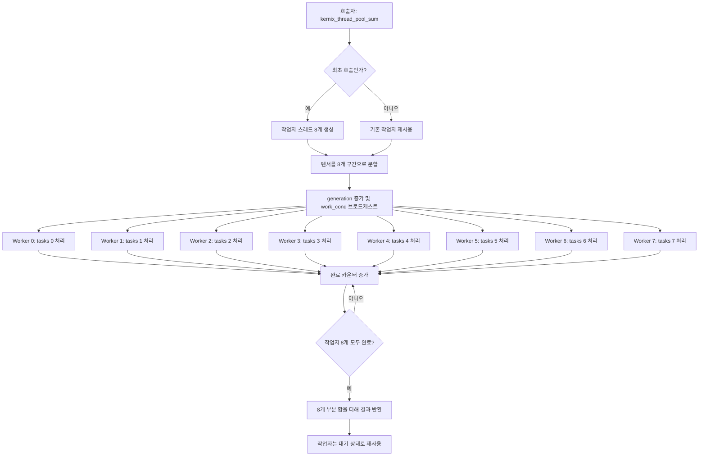

# KERNIX

**KERNIX**는 C로 구현하는 CPU 기반 텐서 연산 라이브러리 프로젝트입니다. 연속 메모리 기반 텐서 자료구조와 기본 연산을 만들고, POSIX Threads와 ARM64 SIMD를 활용해 CPU 연산을 최적화하는 것을 목표로 개발하고 있습니다.

> **개발 상태: 실험적 개발 단계**  
> 현재는 기본 텐서 연산과 대규모 텐서 합산을 실험하고 있습니다. API와 내부 구조는 변경될 수 있습니다.

## 목표

- C 기반의 가벼운 텐서 자료구조와 연산 API 구현
- CPU 멀티스레딩 및 작업자 스레드 재사용 구조 실험
- Clang 최적화와 ARM64 NEON 자동 벡터화 분석
- PyTorch CPU 연산과 비교할 수 있는 재현 가능한 벤치마크 구축
- 이후 행렬 연산 등으로 확장할 수 있는 병렬 실행 기반 설계

## 현재 구현

| 영역 | 기능 | 상태 |
|---|---|---|
| 자료구조 | `float_tensor`, `int_tensor`, `uint8_tensor` | 구현됨 |
| 메모리 유틸리티 | `float_zeros`, `int_zeros`, `uint8_zeros`, 타입별 해제 함수 | 구현됨; 실패 처리 보완 필요 |
| 텐서 출력 | 정수·실수·uint8 텐서 출력 함수 | 구현됨 |
| 원소 연산 | `int_dot`, `float_dot`, `uint8_dot` | 구현됨; 크기 계산 검증 필요 |
| 원소별 덧셈 | `ints_add`, `floats_add` | 구현됨 |
| 행렬 곱셈 | `int_matmul`, `float_matmul` | 기본 구현됨; 성능 최적화 예정 |
| 병렬 합산 | 8개 작업 구간으로 분할해 병렬 합산 | 구현됨 |
| 스레드 풀 | 작업자 스레드 재사용, 조건 변수 기반 작업 알림 및 완료 대기 | 실험 구현됨 |
| SIMD | Clang의 ARM64 NEON 자동 벡터화 분석 | 실험 중 |

## 스레드 풀 구조

현재 스레드 풀은 **고정된 8개 작업자와 8개 작업 슬롯을 재사용하는 구조**입니다. 일반적인 FIFO 작업 큐는 아니며, 각 작업자는 매 실행마다 자신의 고정 슬롯에 설정된 텐서 구간을 처리합니다.



### 동기화 구성요소

- `pthread_mutex_t mutex`: 풀의 공유 상태와 완료 카운터 보호
- `work_cond`: 새 작업 배치를 작업자에게 알림
- `done_cond`: 모든 작업자의 작업 완료를 호출자에게 알림
- `generation`: 새로운 작업 배치를 식별하는 세대 번호
- `completed`: 현재 배치에서 작업을 끝낸 작업자 수
- `stopping`: 풀 종료 요청 상태

작업자는 합산 중에는 뮤텍스를 해제하므로 각 데이터 구간을 병렬로 처리할 수 있습니다. 합산이 모두 끝나면 호출자가 부분 합을 모읍니다. 풀은 프로그램 종료 시 `kernix_thread_pool_shutdown()`으로 정리합니다.

### 현재 스레드 풀의 제한

- 기본 작업자 수가 8개로 고정되어 있습니다.
- 현재 API는 여러 호출자가 동시에 `kernix_thread_pool_sum()`을 호출하는 용도를 지원하지 않습니다.
- 작업자별 고정 슬롯을 사용하므로 임의 작업을 넣는 범용 작업 큐는 아닙니다.
- 풀 종료 후 재초기화하는 수명주기는 지원하지 않습니다.
- 장기적으로 풀 상태와 함수 구현을 헤더에서 분리해 `.c` 파일에 두는 작업이 필요합니다.

## 빌드 및 실행

현재 개발 환경은 Apple Silicon Mac, Clang, POSIX Threads 기반입니다. 저장소에서 `test/` 디렉터리로 이동한 뒤 다음과 같이 컴파일할 수 있습니다.

```bash
cd test
clang -O3 -pthread -I../include Dynamic_thread_test.c -o DTT
./DTT
```

이 명령은 `include/KERNIX.h`와 `test/Dynamic_thread_test.c` 구조를 가정합니다. 실제 디렉터리 구성이 다르면 `-I` 옵션과 소스 경로를 조정하세요.

## 벤치마크

### 최신 기록

테스트는 100,000,000개의 `float32` 원소를 합산합니다. 모든 원소는 `1.0f`이며, 배열의 논리 데이터 크기는 약 400 MB입니다. 두 구현 모두 8개 스레드를 사용하며, 워밍업 후 같은 텐서를 재사용해 20회 측정했습니다.

| 지표 | KERNIX 스레드 풀 | PyTorch CPU |
|---|---:|---:|
| 원소 개수 | 100,000,000 | 100,000,000 |
| 자료형 | `float32` | `torch.float32` |
| 스레드 수 | 8 | 8 |
| 측정 횟수 | 20 | 20 |
| 평균 실행 시간 | 6.917 ms | 8.652 ms |
| 중앙값 실행 시간 | **6.920 ms** | 8.772 ms |
| 최솟값 | 6.852 ms | 7.059 ms |
| 최댓값 | 7.027 ms | 10.135 ms |

이 측정에서 KERNIX의 중앙값은 PyTorch보다 약 **21.1% 짧았습니다**. 이는 특정 Mac 환경과 현재 구현에서 관측한 결과입니다. 모든 종류의 연산에서 KERNIX가 PyTorch보다 빠르다는 뜻은 아니며, 측정 결과는 CPU 부하·스케줄링·클럭·메모리 상태 등에 영향을 받을 수 있습니다.

측정 경계와 내부 구현이 완전히 같지는 않으므로, 결과를 공개 성능 주장으로 사용하기 전에 실행 순서를 번갈아 가며 여러 번 반복하고 정확성 테스트도 확대할 계획입니다.

## 구현 및 성능 최적화 방향

### 1. 안정성과 정확성

- 모든 메모리 할당 결과 확인 및 실패 경로 처리
- 음수 차원과 차원 곱셈의 `size_t` 오버플로 검사
- 원소 수 및 인덱스 계산을 `size_t`로 일관되게 관리
- `float_dot()`과 `uint8_dot()`의 크기 계산 타입 수정
- 덧셈·행렬 곱셈의 입력 포인터와 차원 호환성 검사
- 크기 0, 1, 7, 8, 9 및 큰 텐서와 다양한 입력값으로 테스트
- 단일 스레드 기준 구현과 비교해 오차 검증

### 2. 스레드 풀 구조 개선

- 초기화·작업 제출·완료 대기·종료 API 분리
- 구현을 `.c` 파일로 이동하고 헤더에는 선언을 유지
- 작업자 수를 설정할 수 있도록 확장
- 필요할 경우 `parallel_for` 또는 범용 작업 큐 검토
- 동시 호출을 지원할지 API 계약을 명확히 정의

### 3. CPU 최적화

- 작업자 수를 1, 2, 4, 6, 8 등으로 바꾸며 측정
- 누산기 개수와 `float`/`double` 누산 방식 비교
- 실제 최종 소스에서 Clang 어셈블리를 생성해 NEON 벡터화 확인
- 직접 SIMD intrinsic을 작성하기 전 컴파일러 자동 벡터화 결과 측정
- 메모리 대역폭과 스레드 동기화 오버헤드 구분

### 4. 벤치마크 품질

- 워밍업 및 측정 구간을 동일한 기준으로 맞춤
- 데이터 생성·초기화·출력 시간을 측정 구간에서 제외
- 각 프로그램을 번갈아 실행해 실행 순서의 영향을 완화
- 반복 측정의 중앙값과 분산을 함께 기록
- cold-start 시간과 스레드 풀 재사용 시간을 별도 지표로 관리

## 개발 로드맵

- [ ] 텐서 생성·해제 코드의 할당 실패 및 오버플로 처리
- [ ] 차원 검증과 다양한 입력값에 대한 정확성 테스트 추가
- [ ] 스레드 풀 구현을 헤더에서 별도 `.c` 파일로 분리
- [ ] 작업자 수 설정 및 재현 가능한 벤치마크 자동화
- [ ] NEON 자동 벡터화 및 누산기 구성 비교
- [ ] 행렬 곱셈 등 연산을 위한 병렬 실행 인터페이스 검토

## 기술 스택

- **언어:** C
- **병렬화:** POSIX Threads (`pthread`)
- **컴파일러:** Clang (`-O3`)
- **현재 개발·측정 환경:** Apple Silicon Mac, CPU 실행
- **비교 대상:** PyTorch CPU (`torch.float32`)

## 라이선스

라이선스는 아직 명시하지 않았습니다. 공개 배포 전에 저장소에 적절한 `LICENSE` 파일을 추가하세요.
